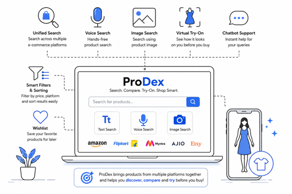
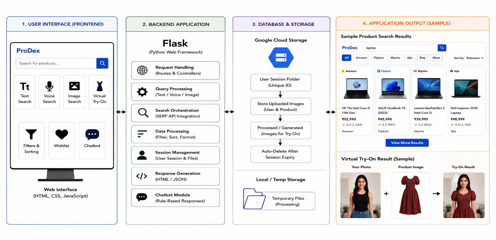

# ProDex - Multi-Platform Product Search with Virtual Try-On

## Overview

ProDex is a smart product aggregation platform that enables users to
search products from multiple e-commerce websites through a single
interface. Users can search using **Text, Voice, or Image**, compare
products, apply filters, and preview clothing using an AI-powered
**Virtual Try-On** feature before making a purchase decision.

## Problem Statement

Online shopping often requires users to search across multiple e-commerce websites, making product comparison time-consuming and inefficient. In addition, users cannot easily visualize how a clothing item will look on them before making a purchase, leading to uncertainty in buying decisions. ProDex addresses these challenges by providing a unified multi-platform product search with text, voice, and image search, AI-powered Virtual Try-On, filtering, sorting, wishlist, and chatbot support.

## Technologies

-   Frontend: HTML, CSS, JavaScript
-   Backend: Flask (Python)
-   Cloud: Google Cloud Storage, Cloud Run
-   APIs: SerpApi, Google Lens Engine, Virtual Try-On API
-   AI: Google Vertex AI
-   Voice: WebKit Speech Recognition

## Features

-   **Text Search**
    -   Users can type a product name and search across platforms like
        Amazon, Flipkart, Myntra, etc.
    -   Uses SERP API to fetch real-time product results.
-   **Voice Search**
    -   Users can speak the product name using the microphone.
    -   Implemented using the WebKit Speech Recognition API.
-   **Image Search**
    -   Users can upload a product image.
    -   The system processes the image and finds visually similar
        products.
-   **Virtual Try-On**
    -   Users can upload their photo and preview how apparel items look
        on them.
    -   Implemented using Google Vertex AI and Google Cloud Storage.
-   **Wishlist**
    -   Users can save products to a wishlist for later viewing.
-   **Chatbot Support**
    -   A simple chatbot helps users with product search and queries.

## Project Workflow

### 1. User Search Input
The user searches for a product using **text, voice, or an image upload**.

### 2. Input Processing
- **Text input:** Sent directly to the backend.
- **Voice input:** Converted into text using **WebKit Speech Recognition**, then processed as a normal search query.
- **Image input:** The uploaded image is analyzed and converted into a **textual product description**, which is then used as a search query.

### 3. Backend Request Handling
The processed search query is sent to the **Flask backend**, which prepares the search parameters.

### 4. Product Retrieval
The backend calls **SERP API** to fetch product results from multiple e-commerce platforms such as **Amazon, Flipkart, Myntra, Ajio, Etsy**, and others.

### 5. Filtering and Sorting
The retrieved products are refined based on user-selected filters, including:

- **Maximum price range**
- **Preferred shopping platforms** (Amazon, Myntra, Ajio, Etsy, etc.)
- **Sorting options** such as price or relevance

### 6. Displaying Results
The filtered products are returned to the frontend and displayed to the user.

### 7. Virtual Try-On Feature
If the user wants to see how an apparel item looks on them, they can select the **Virtual Try-On** option.

- The user uploads their photo.
- The system processes the user's image and the selected product image.
- Using **Google Vertex AI**, a new image is generated showing the user wearing the selected dress.

## Working

### Text Search

User → Flask → SerpApi → Multiple E-commerce Platforms → Results

### Voice Search

User Speech → WebKit Speech Recognition → Text → Flask → SerpApi →
Results

### Image Search

1.  User uploads image.
2.  Image stored in Google Cloud Storage.
3.  SerpApi (Google Lens) analyzes the image.
4.  Search query generated.
5.  Query cleaned.
6.  Cleaned query searches multiple e-commerce platforms.
7.  Results displayed.

### Virtual Try-On

1.  User selects a product.
2.  User uploads an image.
3.  Image stored in Google Cloud Storage.
4.  Upload triggers Cloud Run.
5.  Cloud Run extracts the selected product image.
6.  Both images are sent to the Virtual Try-On API.
7.  Generated image is saved in the user's session folder.
8.  Result displayed.
9.  Session folder is automatically deleted when the user closes the
    generated image.

## Privacy & Security

-   Unique session folder for every user.
-   Temporary image storage only.
-   Automatic deletion after use.
-   User data remains isolated.

## My Role

-   Developed the multimodal search pipeline.
-   Implemented voice and image search.
-   Integrated Google Cloud Storage.
-   Integrated Virtual Try-On workflow.
-   Worked with Cloud Run and APIs.
-   Performed query processing and debugging.

## Future Enhancements

-   Affiliate Marketing
-   Personalized recommendations
-   More shopping platforms
-   Price alerts
-   User accounts

## Conclusion

ProDex provides a unified, AI-powered shopping experience by combining
multimodal search, cloud services, and Virtual Try-On to help users
discover products faster and make better purchase decisions.
